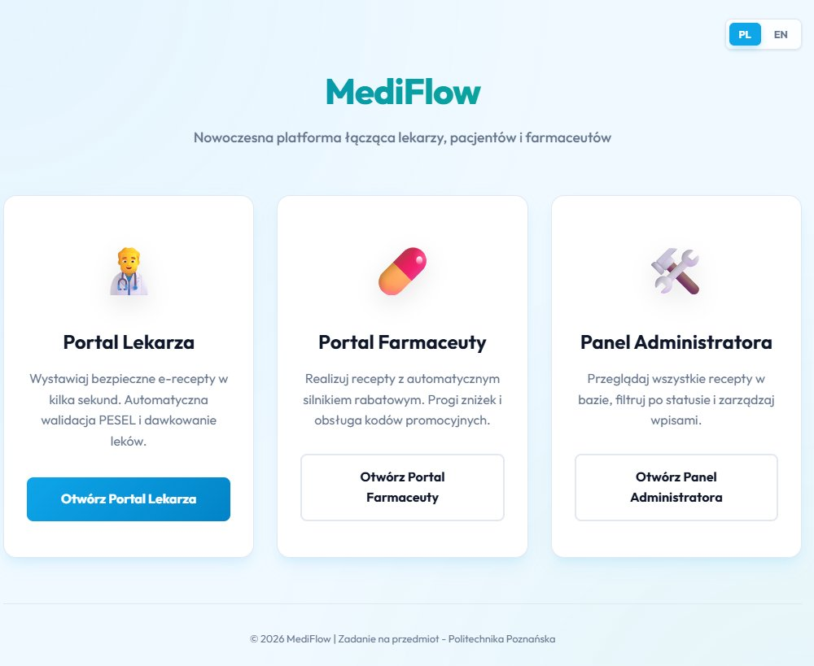

# 💊 MediFlow

A web application for issuing and fulfilling e-prescriptions, created as an assignment for the **Organization of Commercial Services on the Internet** course at Poznan University of Technology.

Built with Node.js, Express, MongoDB, and plain HTML, CSS, and JavaScript. Doctors can create e-prescriptions with a generated 4-digit PIN, pharmacists can look them up by PESEL + PIN with an automatic discount engine, and admins can browse and manage all records in the database.



---

## 🖥️ Portals

- **Doctor Portal (`doctor.html`):** Issue new e-prescriptions with 11-digit PESEL validation, add medications (name, package quantity, unit price, dosage, refundable flag), and generate a 4-digit access PIN.
- **Pharmacist Portal (`pharmacy.html`):** Look up prescriptions using PESEL + PIN, dispense selected items (partial or full fulfillment), apply promo codes, calculate tiered discounts, and print receipts.
- **Admin Panel (`admin.html`):** View live counts of active and fulfilled prescriptions, filter by status (*All / Active / Fulfilled*), search by PESEL, PIN, or medication name, and delete individual or fulfilled records.

---

## 💰 Discount Rules

Discounts apply **only to refundable medications**. Tier discounts and promo codes **do not stack** — the system automatically applies whichever discount is higher.

### Automatic Tiers
| Refundable Subtotal | System Discount |
| :--- | :--- |
| ≥ 200 PLN | **5%** |
| ≥ 500 PLN | **15%** |
| ≥ 1000 PLN | **25%** |

### Promo Codes
| Code | Discount |
| :--- | :--- |
| `MEDI10` | **10%** |
| `RABAT20` | **20%** |

---

## ⚙️ Features

- **Bilingual UI (PL / EN):** Instant language switcher in the header of every page, persisted in `localStorage`.
- **Partial Fulfillment:** Patients can buy only selected medications from a prescription; each item tracks its own `pending` / `done` status.
- **Discount Progress Bar:** Shows live progress toward the next discount tier and explains which discount is currently applied.
- **Custom Notifications:** Styled toast alerts and confirmation modals instead of native browser popups.
- **Print-Friendly Receipt:** Dedicated `@media print` stylesheet for printing transaction summaries.
- **Responsive Layout:** Clean card-based interface that adapts to desktop and mobile screens.

---

## 📡 API Endpoints

| Method | Endpoint | Description |
| :--- | :--- | :--- |
| `GET` | `/api/prescriptions` | List all prescriptions (newest first) |
| `POST` | `/api/prescriptions` | Create a new e-prescription and return its PIN |
| `GET` | `/api/prescriptions/:pesel/:pin` | Fetch a prescription by PESEL and PIN |
| `POST` | `/api/prescriptions/buy` | Mark selected medications as dispensed |
| `GET` | `/api/prescriptions/stats/active` | Count active prescriptions |
| `GET` | `/api/prescriptions/stats/used` | Count fulfilled prescriptions |
| `DELETE` | `/api/prescriptions/used` | Delete all fulfilled prescriptions |
| `DELETE` | `/api/prescriptions/:id` | Delete a single prescription by ID |

---

## 🗄️ Data Model (MongoDB)

Stored in the `prescriptions` collection of the `mediflow` database:

```json
{
  "pesel": "95010112345",
  "pin": "1111",
  "status": "active",
  "medications": [
    {
      "name": "Xarelto 20mg",
      "dosage": "1-0-0",
      "quantity": 2,
      "price": 180.00,
      "canDiscount": true,
      "status": "pending"
    }
  ],
  "createdAt": "2026-05-12T10:00:00.000Z"
}
```

---

## 💻 Setup & Running

### Requirements
- **Node.js** (v18 or newer)
- **MongoDB** (local instance or MongoDB Atlas)

### Run Locally
```bash
git clone https://github.com/kkamilll/MediFlow.git
cd MediFlow
npm install
```

1. *(Optional)* Copy `.env.example` to `.env` if you use MongoDB Atlas or a custom port (defaults to `PORT=3000` and `mongodb://127.0.0.1:27017/mediflow`):
   ```env
   PORT=3000
   MONGO_URI=mongodb://127.0.0.1:27017/mediflow
   ```
2. Start the server:
   ```bash
   # Standard mode
   npm start

   # Development mode (nodemon)
   npm run dev
   ```
   On Windows, `npm run win-start` and `npm run win-dev` are also available to automatically free port `3000` before starting.
3. Open `http://localhost:3000` in your browser.

---

## 📁 Project Structure

```text
MediFlow/
├── docs/
│   └── preview.jpg         # Application preview image
├── public/
│   ├── index.html          # Dashboard (portal selector)
│   ├── doctor.html         # Doctor portal
│   ├── pharmacy.html       # Pharmacist portal
│   ├── admin.html          # Admin panel
│   ├── css/style.css       # Styles, animations, and print layout
│   └── js/
│       ├── i18n.js         # PL / EN localization
│       ├── ui.js           # Toast notifications and confirm modals
│       ├── doctor.js       # Prescription creation and validation
│       ├── pharmacy.js     # Fulfillment and discount engine
│       └── admin.js        # Admin panel filtering and management
├── server/
│   ├── server.js           # Express server and REST API
│   └── models/
│       └── Prescription.js # Mongoose prescription schema
├── .env.example            # Environment variables template
├── package.json            # Dependencies and scripts
└── README.md               # Documentation
```

---

## 📄 Author

Created by [Kamil](https://github.com/kkamilll).
